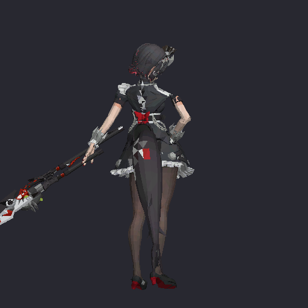

<p align="center">
  
</p>

<h1 align="center">Ellen Joe League Skins</h1>

<p align="center">Ellen Joe from Zenless Zone Zero, brought to League of Legends.</p>

<p align="center">
  <a href="https://github.com/runefoo/ellen-joe-league-skins/releases/tag/talon-v2.4.0"></a>
  
  <a href="https://github.com/runefoo/ellen-joe-league-skins/actions/workflows/validate.yml"></a>
</p>

<p align="center">
  <a href="https://github.com/runefoo/ellen-joe-league-skins/releases/tag/talon-v2.4.0">Download</a> ·
  <a href="docs/INSTALLATION.md">Installation</a> ·
  <a href="docs/KNOWN_ISSUES.md">Known issues</a> ·
  <a href="CREDITS.md">Credits</a>
</p>

## Skins

| Champion | Version | Status | Download |
| --- | --- | --- | --- |
| Talon — base skin | 2.4.0 | Prerelease; in-game verification pending | [Download .fantome](https://github.com/runefoo/ellen-joe-league-skins/releases/download/talon-v2.4.0/Ellen_Joe_Talon_V2_4.fantome) |

This repository is dedicated to **Ellen Joe custom skins for League of Legends**. Talon is the first maintained skin here. The original Ellen Joe Samira mod is credited as an input to this adaptation; it is not presented as a separately maintained release.

## Ellen Joe × Talon

- Ellen model re-proportioned to an upright Talon rig, with right-hand scissors.
- Animated 16-joint shark tail and hand-on-hip idle.
- Bent-elbow homeguard, low lateral tail sway, compact melee Q, and repaired E wall-vault clips.
- Adapted recall choreography with 17 particle events and 12 effect definitions.

<p align="center"></p>

The preview above comes from the skin package. The portrait at the top is AI-generated project artwork; neither image establishes in-game compatibility.

## Install

1. Download `Ellen_Joe_Talon_V2_4.fantome` from the [v2.4 prerelease](https://github.com/runefoo/ellen-joe-league-skins/releases/tag/talon-v2.4.0).
2. Import it into a mod manager that supports `.fantome` packages, following the manager's instructions.
3. Enable only one Talon skin replacement and select **base Talon** in League.
4. Use Practice Tool for the [in-game acceptance checks](docs/KNOWN_ISSUES.md) before treating this version as verified.

See [installation and troubleshooting](docs/INSTALLATION.md) for manager links and checksum verification.

## Validation and compatibility

The supplied v2.4 reports record **80 passing offline package/motion checks**, plus recall dependency and transition checks. These are historical build reports, not fresh in-game results. No League patch has been verified in-game for this release. [Known issues](docs/KNOWN_ISSUES.md) tracks the remaining checks and retained compromises.

The repository's CI separately verifies the published package checksum, ZIP integrity, and metadata. Run it locally with Python 3.10+:

```sh
python3 scripts/verify_package.py
```

## Repository layout

```text
assets/                  Project icon and package preview
skins/talon/2.4.0/        Installable skin, metadata, checksum
tools/talon/             Preserved build and inspection scripts
docs/                    Installation, build notes, known issues, validation
scripts/                 Lightweight package verification
.github/                 CI and contribution templates
```

See [build notes](docs/BUILDING.md) before using the legacy tooling: the saved source snapshot does not include the complete cold-build environment.

## Contributing

Bug reports, in-game validation, and Ellen Joe adaptations are welcome. Read [CONTRIBUTING.md](CONTRIBUTING.md), retain source credits, and include the League patch and skin version in reports.

## Credits and rights

Built on **aemeth talon by ceerel** (rig and animations) and **ellen joe samira by disco** (Ellen model and recall), as recorded in the package metadata. See [CREDITS.md](CREDITS.md) for provenance and asset-rights notes.

Unofficial fan project. Not affiliated with Riot Games or HoYoverse.
